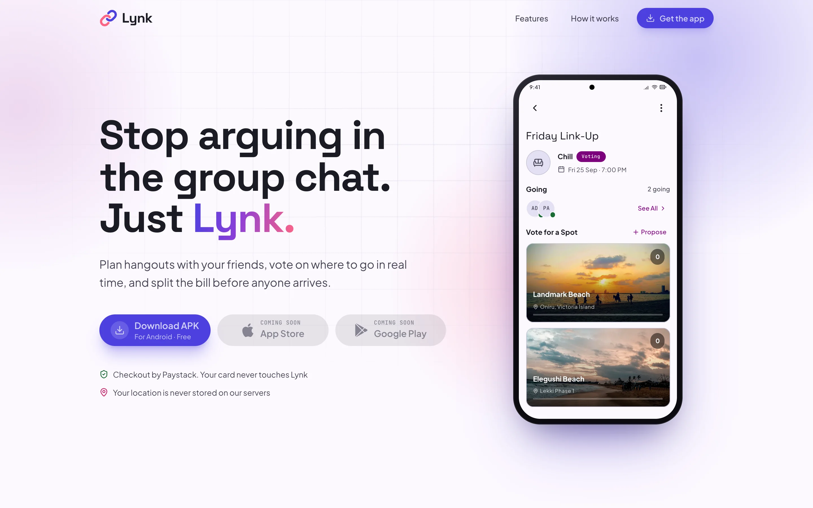

# Lynk Web

Stop arguing in the group chat. Just Lynk.

Friends create a hangout, invite their squad, vote on a spot everyone can reach, split the bill, and show up. This is
the website: a landing page that shows the app at work, plus the Terms of Service and Privacy Policy, built with
**Astro** and **Tailwind CSS** as a fully static site and served by Cloudflare Workers.

**Live:** https://lynk.com.ng · **Client:** [Lynk (KMP)](https://github.com/EEseka/Lynk) ·
**Backend:** [Lynk API](https://github.com/EEseka/lynk-api)

---

<picture>
  <source media="(prefers-color-scheme: dark)" srcset="docs/landing-dark.webp" />
  
</picture>

## The demos

Every demo on the page is built from HTML and CSS, not a video. The phone screens use the app's own colours, type,
shapes and components, so they look like the app because they are made from the same values. These clips were recorded
from the site itself.

<table>
  <tr>
    <td align="center" width="50%">
      <picture>
        <source media="(prefers-color-scheme: dark)" srcset="docs/demos/hero-dark.avif" />
        
      </picture>
      <br><b>One hangout, start to finish</b><br>Friends join, vote, lock in a spot and pay their share
    </td>
    <td align="center" width="50%">
      <picture>
        <source media="(prefers-color-scheme: dark)" srcset="docs/demos/vote-dark.avif" />
        
      </picture>
      <br><b>Vote in real time</b><br>Votes land live, the leader moves to the top, and the host closes voting
    </td>
  </tr>
  <tr>
    <td align="center" width="50%">
      <picture>
        <source media="(prefers-color-scheme: dark)" srcset="docs/demos/assistant-dark.avif" />
        
      </picture>
      <br><b>Lynk AI</b><br>Ask where to go, and it searches real places and suggests a few for the ballot
    </td>
    <td align="center" width="50%">
      <picture>
        <source media="(prefers-color-scheme: dark)" srcset="docs/demos/middle-dark.avif" />
        
      </picture>
      <br><b>Meet in the middle</b><br>Where everyone is gives a group centre, and spots come from around it
    </td>
  </tr>
  <tr>
    <td align="center" width="50%">
      <picture>
        <source media="(prefers-color-scheme: dark)" srcset="docs/demos/split-dark.avif" />
        
      </picture>
      <br><b>Split the bill</b><br>Everyone pays their share before the day, and the host gets the total
    </td>
    <td align="center" width="50%">
      <picture>
        <source media="(prefers-color-scheme: dark)" srcset="docs/demos/album-dark.avif" />
        
      </picture>
      <br><b>The album</b><br>Everyone's photos from the hangout in one place, with captions
    </td>
  </tr>
</table>

## Pages

| Page         | What it is                                                                                    |
|--------------|-----------------------------------------------------------------------------------------------|
| **/**        | The landing page, with the demos above and two rows of trending spots in Lagos                |
| **/terms**   | Terms of Service, written in Markdown                                                         |
| **/privacy** | Privacy Policy, written in Markdown and grounded in what the app and API actually store       |
| **/credits** | Credits for the spot and album photos                                                         |
| **/open**    | Where hangout links land when the app does not open them, kept out of search                  |
| **404**      | Custom not-found page, kept out of search                                                     |

Emails from Lynk link to `https://lynk.com.ng/hangouts/<id>`. On Android with Lynk installed, the hangout opens in the
app straight away, because `/.well-known/assetlinks.json` proves the site and the app belong together. Everywhere else,
`public/_redirects` serves `/open`, which shows an Open in Lynk button for anyone who has the app on that phone and
download buttons for anyone who does not.

## Built with

<table>
  <tr>
    <td align="center" width="110"><br><b>Astro</b><br>7.3</td>
    <td align="center" width="110"><br><b>Tailwind CSS</b><br>4.3</td>
    <td align="center" width="110"><br><b>TypeScript</b><br>scripts</td>
    <td align="center" width="110"><br><b>Node.js</b><br>build</td>
    <td align="center" width="110"><br><b>Cloudflare Workers</b><br>hosting</td>
  </tr>
</table>

## How it is built

- **No JavaScript framework.** Every demo is plain HTML that one small script, `src/scripts/timeline.ts`, steps
  through. A demo lists its pauses in `data-timeline="1000,1100,…"`, the script adds a `step-1`, `step-2` class after
  each pause, and CSS does all the moving. When a loop ends, the demo fades out, resets and starts again.
- **Demos only play on screen.** Each one starts when about a third of it is visible and pauses when it scrolls
  away, so the page does no work you cannot see.
- **Reduced motion is respected.** If the phone or computer asks for less motion, every demo shows its finished state
  and nothing moves.
- **The mockups match the app.** The colours, type and shapes in `src/styles/global.css` are copied by value and name
  from the app's `Color.kt`, `Type.kt` and `Shape.kt`, light and dark, and `src/components/app/` holds copies of the
  app's Compose components, such as the vote card and the participant row.
- **Private.** Fonts are self-hosted, so the page makes no requests to Google Fonts, and the site sets no cookies and
  loads no analytics or trackers.

## Running locally

Needs Node 22.12 or newer.

```sh
npm install
npm run dev              # http://localhost:4321
npm run dev -- --host    # also reachable from a phone on the same network
npm run build            # outputs to dist/
npm run preview          # serves the build
```

## Project structure

```text
src/
├── pages/          index.astro, terms.md, privacy.md, credits.astro, open.astro, 404.astro
├── layouts/        BaseLayout (head, header, footer), LegalLayout (terms and privacy)
├── components/     landing page sections
│   ├── app/        copies of the app's Compose components used in the mockups
│   └── features/   voting, Lynk AI, centre point, bill split, album and spot demos
├── scripts/        timeline.ts, which steps the looping demos
├── styles/         global.css (design tokens), app-ui.css (app component styles)
├── assets/         spot and album photos
├── data/           demo people, spots and album, with photo credits
└── site.ts         APK, store and support links
public/
├── .well-known/    assetlinks.json (Android App Links), security.txt
├── _redirects      sends /hangouts/<id> to /open
└── robots.txt, favicon, social image
docs/               the screenshots and clips in this README
```

## Deployment

Cloudflare Workers serves the built `dist/` folder as static assets, deployed on every push to `main`.
`wrangler.jsonc` makes every page work with or without a trailing slash, and serves the custom 404 page for anything
that does not exist.

## Photos

The spots on the landing page are real places in Lagos. Their photos come from Wikimedia Commons under Creative
Commons licences, and a new one needs its file name, author and licence added to `src/data/spots.ts`. The album photos
come from Unsplash under the Unsplash License, credited in `src/data/album.ts`. Both files feed the `/credits` page.

## Releases

The Download APK button links to `https://github.com/EEseka/Lynk/releases/latest/download/lynk.apk`, so each client
release must attach its APK as `lynk.apk`. The App Store and Google Play buttons show as "Coming soon" until their URLs
are set in `src/site.ts`.

## License

All rights reserved. The code is public to read, but not licensed for use. The photos keep their own licences. See
[LICENSE](LICENSE).
